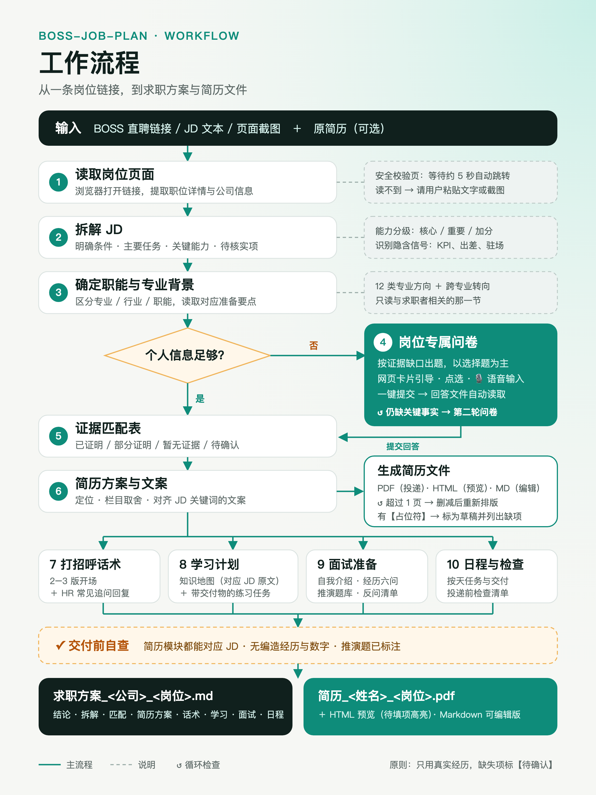
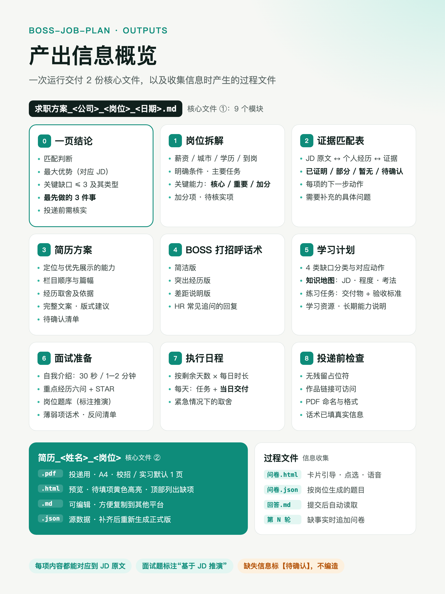

# boss-job-plan

一个 [Claude Code](https://claude.com/claude-code) Skill：把 BOSS 直聘（以及智联、猎聘、企业官网等）上的岗位要求，变成一份**针对这个岗位的完整求职方案和排版好的简历**。

贴一条岗位链接，它会读取并拆解 JD，用网页问卷收集你的真实经历（支持点选和语音），再交付简历、打招呼话术、学习计划、面试准备和按天执行的日程。

<p align="center">
  
  
</p>

## 能做什么

- **拆解岗位**：拆出明确条件、主要任务、关键能力（分核心 / 重要 / 加分）和待核实项，并识别 JD 中的隐含信号，比如 KPI、出差、驻场。
- **岗位专属问卷**：针对证据缺口出题，以网页卡片的形式一屏一题，可以点选，也可以用语音回答，填完一键提交。仍缺关键事实时，会追加下一轮问卷。
- **证据匹配**：把 JD 的每条要求对应到你的真实经历，标为已证明、部分证明、暂无证据或待确认。
- **定制简历**：给出简历方案（定位、栏目取舍、对齐 JD 的文案），并导出 PDF、HTML 和 Markdown 三种格式。生成后自动检查是否超页，以及还有没有未填的占位符。
- **BOSS 打招呼话术**：多个开场版本，加上 HR 常见追问的回复。
- **学习计划**：知识地图写明每个知识点对应 JD 哪句、要学到什么程度、面试怎么考；每项配一个带交付物和验收标准的练习任务。
- **面试准备**：两版自我介绍（30 秒 / 1–2 分钟）、重点经历六问加 STAR 提纲、按岗位推演的题库、薄弱项话术和反问清单。
- **执行日程**：按你剩余的天数和每天的时间排，每天都有明确的交付。

## 原则

**只写你真实做过的事。** 缺失的信息一律标为【待确认】，不编造经历、数据和头衔；推演出来的面试题会明确标注，不冒充公司真题。招聘方会追问细节，编造的内容在面试里一戳就破。

## 安装

```bash
git clone https://github.com/Gayaya999/boss-job-plan.git ~/.claude/skills/boss-job-plan
```

装好后重启 Claude Code，skill 会自动出现。

### 依赖

| 依赖 | 用途 |
|---|---|
| Python 3.8+ | 生成问卷页面和简历文件（只用标准库） |
| Chrome / Edge | 导出简历 PDF（无头模式）；问卷的语音输入（Web Speech API，需要联网） |
| 浏览器工具（可选） | 直接读取 BOSS 直聘链接；没有的话，粘贴 JD 文本或截图也可以 |

## 使用

在 Claude Code 中直接说：

```
帮我看看这个岗位怎么准备：https://m.zhipin.com/…/weijd-job/…
```

```
这是我想投的数据分析实习 JD（粘贴文本），我是统计学大三，帮我出一份完整求职方案
```

```
根据这个岗位，先帮我写一段 BOSS 打招呼的话术
```

典型流程：
1. 读取并拆解 JD，在浏览器中打开岗位专属问卷。
2. 在问卷页面点选或用语音作答，填完后点「提交给 Agent」。
3. 回到对话说一句“填好了”。
4. 拿到 `求职方案_<公司>_<岗位>_<日期>.md` 和 `简历_<姓名>_<岗位>.pdf`。

## 目录结构

```
boss-job-plan/
├── SKILL.md                      # 主流程与规则
├── references/
│   ├── jd-parsing.md             # BOSS JD 字段、隐含信号、能力分级
│   ├── majors.md                 # 12 类专业方向和跨专业转向的准备重点
│   ├── resume-and-interview.md   # 简历文案、打招呼话术、面试准备
│   ├── learning-plan.md          # 缺口分类、知识地图、练习任务、排期
│   ├── questionnaire.md          # 问卷出题规则与 JSON 格式
│   └── resume-render.md          # 简历 JSON 格式与版面规则
├── assets/
│   ├── plan-template.md          # 求职方案输出模板
│   ├── form-template.html        # 卡片式问卷页面（含语音输入）
│   └── resume-template.html      # 简历排版模板（A4）
├── scripts/
│   ├── make_form.py              # 生成问卷，--serve 启动本地服务并接收提交
│   └── make_resume.py            # 简历 JSON → PDF / HTML / Markdown，并检查页数和占位符
└── evals/                        # 测试用例（可用 claude plugin eval 运行）
```

## 注意事项

- BOSS 直聘的分享链接会先进入安全校验页，等待几秒后才会跳转到职位详情。如果遇到登录或验证码，skill 不会尝试绕过，会请你粘贴 JD 文本或发截图。
- 问卷和你填写的个人信息只保存在本机：浏览器的本地存储，以及工作目录里的文件。本地服务只监听 127.0.0.1。
- 运行时生成的方案、简历和问卷文件已经加入 `.gitignore`，避免误提交个人信息。

## 致谢

方法框架参考了公开的求职经验内容，以及作者自己整理的《不同专业与岗位的求职准备经验总结》《岗位确定后的简历与面试方案》。专业方向与练习任务是实践框架，不代表就业市场排名；具体的资格与岗位要求，以招聘方的最新公告为准。
